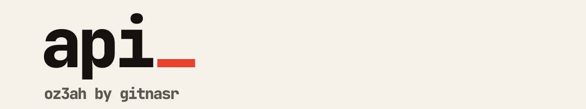

<picture>
  <source media="(prefers-color-scheme: dark)" srcset=".github/banner-dark.svg">
  
</picture>

Backend for Oz3a, a link shortener. It creates short links, redirects visits, records analytics and manages subscriptions.

[Website](https://oz3a.top) · [Frontend](https://github.com/oz3ah/frontend) · [Extension](https://github.com/oz3ah/extension)

## What it does

- Creates short links, lists a user's links, and activates or deactivates them.
- Resolves a short URL and records the visit (device and location through IPinfo).
- Serves analytics, activity, packages and subscription status.
- Issues API keys and pairs the browser extension with an account using a pair code.
- Signs users in with Google and authorizes requests with JWT bearer tokens.

## Stack

.NET 8, ASP.NET Core, Entity Framework Core on PostgreSQL, Hangfire for background jobs, FluentValidation, AutoMapper, Serilog for logs, Infisical for secrets.

## Layout

| Project | Role |
| :--- | :--- |
| `Shortha` | Web API: controllers, filters, middleware, startup |
| `Shortha.Application` | Services, validation, mapping |
| `Shortha.Domain` | Entities and contracts |
| `Shortha.Infrastructre` | Database, jobs, external clients, logging |

## Run it

```bash
dotnet restore Shortha.sln
dotnet run --project Shortha
```

Secrets are read from Infisical, and from a `.env` file for local runs. Ask the maintainer for the variable list. Nothing secret is committed here.

Build the container with `docker build -t oz3a-api .`. Every push to `main` builds the image and publishes it to Docker Hub.

## Contributing

Branch from `dev`, keep commits small, and open a pull request.
